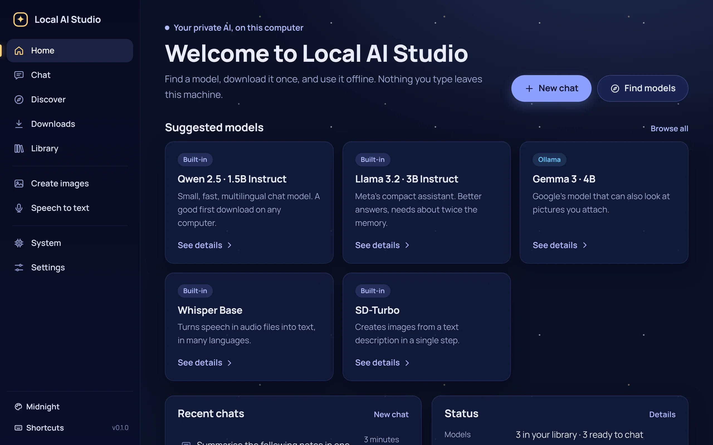
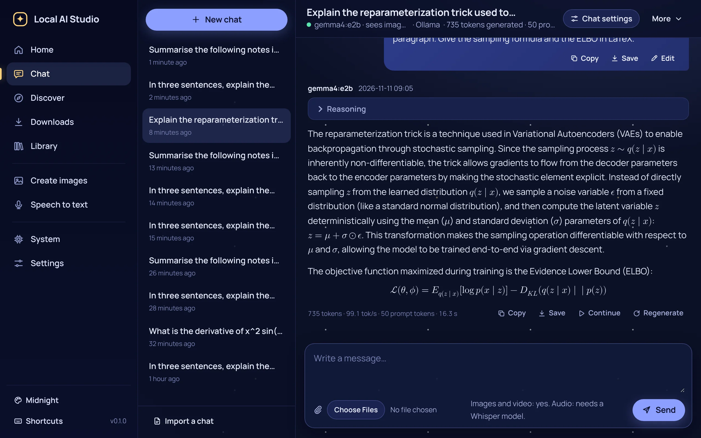
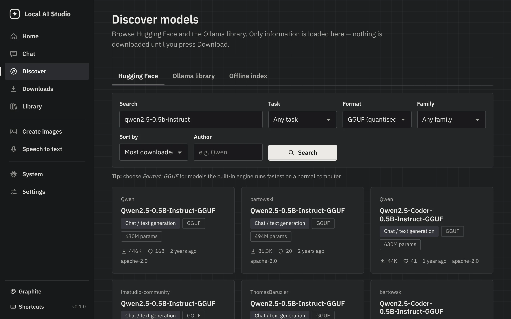
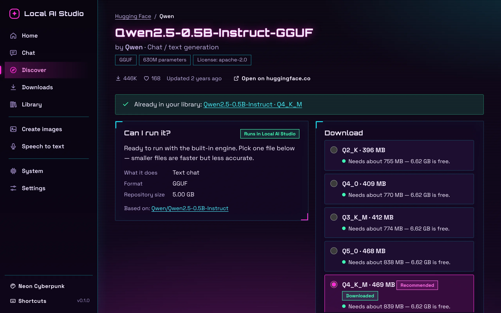
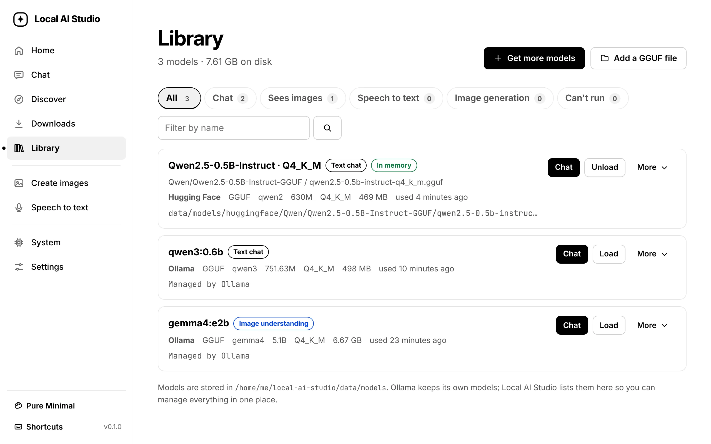
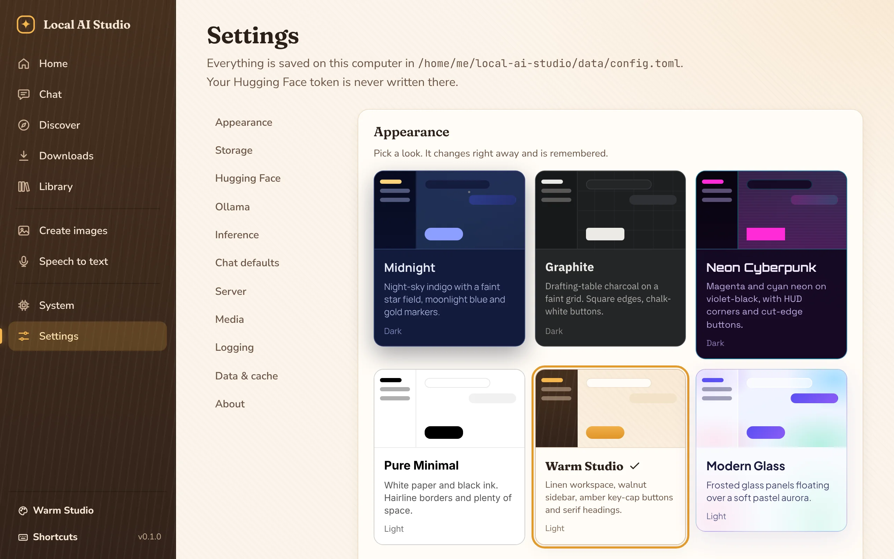
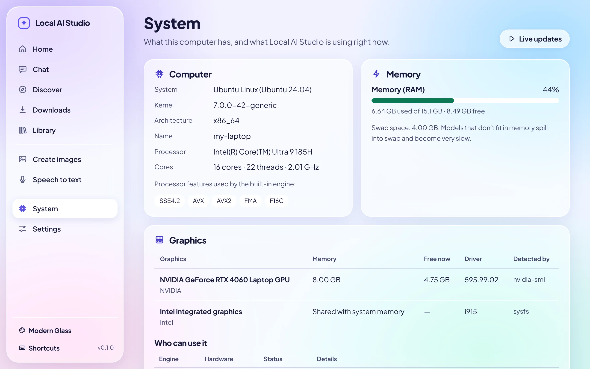
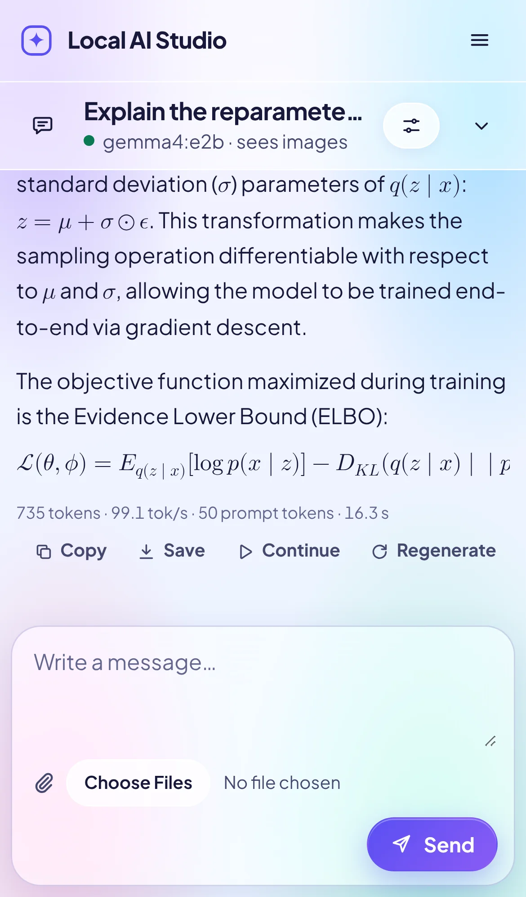

# Local AI Studio

**Author:** Bhavesh G and Claude (Opus 5.5)

*Find, download and run AI models on your own computer — privately, without the cloud.*

---

## 1. Abstract

Local AI Studio is a single program that turns your computer into a private AI workstation.
It lets you browse the model catalogs of **Hugging Face** and **Ollama**, download models with a
real download manager, see whether a model can run on your hardware, and then use it: chat with
text models, ask vision models about pictures and videos, transcribe recordings with Whisper, and
create images with Stable Diffusion.

Everything runs locally. Inference uses a native Rust engine built on
[Candle](https://github.com/huggingface/candle), and — when it is installed — the
[Ollama](https://ollama.com) server for the thousands of models it supports. The interface is a
web page served by the program on `127.0.0.1`; it is written in plain HTML and CSS with **no
JavaScript at all**, so it works in any browser, stays fast and has a very small attack surface.

Why it is useful:

- **Private by default.** Prompts, files and answers never leave your computer. The server
  listens only on this machine unless you explicitly allow your network.
- **One place for both ecosystems.** Hugging Face files and Ollama models are listed, downloaded,
  inspected and deleted from the same library.
- **Honest about hardware.** Every model page estimates the memory it needs and says plainly when
  something won't run — and why — instead of failing later.
- **Made for non-experts.** Plain language, big buttons, empty states that say what to do next,
  and six carefully designed themes.

## 2. Features

Legend: ✅ implemented and tested · 🧪 implemented, depends on your hardware/models (see
[Testing](#9-testing)) · 🚧 not implemented (see [Future improvements](#12-future-improvements)).

### Model discovery
- ✅ Hugging Face search with filters (task, format, model family, author) and sorting (trending,
  downloads, likes, recently updated, newest), with pagination and rate-limit awareness.
- ✅ Model pages: author, task, formats, parameter count, downloads, likes, license, file list with
  sizes, model card, and a **“Can I run it?”** verdict with a per-file memory estimate.
- ✅ Ollama library browsing (search, “sees images”/tools/thinking filters, versions with size,
  context window and input types). ollama.com has no public catalog API, so its pages are read
  defensively and cached; if its layout changes, the app shows an error instead of wrong data.
- ✅ Offline index: everything you browse is stored in a local full-text index (SQLite FTS5) that
  can be searched without internet; **Update index** crawls both catalogs on request (it never
  tries to mirror whole catalogs).
- ✅ Graceful behaviour without internet, during Hub outages (cached pages are shown with a
  notice) and when rate-limited.

### Model downloading
- ✅ Download manager with progress, speed, time remaining, pause, resume, cancel, retry.
- ✅ Resumes from where it stopped (HTTP ranges), also after the app was closed or crashed.
- ✅ Every file is verified: SHA-256 for large (LFS/Xet) files, git blob id for small files.
- ✅ Disk-space check before starting; configurable models and download folders.
- ✅ Duplicate detection (same model twice is refused; identical files are hard-linked, not
  stored twice).
- ✅ Safetensors, sharded checkpoints, tokenizer/config files, diffusers folders (including the
  CLIP tokenizer files Stable Diffusion needs from other repositories).
- ✅ Gated and private repositories with a Hugging Face token (stored in the OS keychain).
- ✅ Ollama pulls with progress; Ollama install instructions per OS when it isn't running.

### Local inference
- ✅ Backend abstraction (`ChatEngine` trait) with two engines: the built-in Candle engine and
  Ollama. Adding another engine means implementing one trait.
- 🧪 Built-in engine, **GGUF** chat models: Llama (2/3/3.x), Mistral, Qwen 2/2.5/3, Phi-3/3.5/4,
  Gemma 1/2/3, GLM-4, LFM2 — quantisations Q4_0…Q8_0, K-quants (Q2_K–Q6_K), F16/F32. IQ/TQ
  quantisations and split files run through Ollama instead.
- 🧪 Built-in engine, **safetensors** chat models: Llama, Mistral, Qwen 2/3, Phi-3 (needs much
  more memory than GGUF).
- ✅ Chat templates from the model itself (Jinja via MiniJinja), context-window management,
  stop/cancel, seed, temperature, top-p, top-k, repetition penalty, max tokens.
- ✅ Hardware detection: CPU model/cores/features, RAM, disks, GPUs (NVIDIA via `nvidia-smi`,
  Apple via `system_profiler`, AMD/Intel via sysfs/CIM where available).
- 🧪 GPU acceleration in the built-in engine **only** when built with `--features cuda` (NVIDIA)
  or `--features metal` (Apple Silicon); the default build is CPU-only and says so. Ollama uses
  GPUs on its own.
- ✅ Memory management: idle models are unloaded after a configurable time; a limit on loaded
  models; a load is refused with an explanation when a model clearly can't fit.

### Chat
- ✅ Multiple conversations with history, rename, delete, persistent storage (SQLite).
- ✅ Streaming answers (streamed HTML — no JavaScript), Stop, Regenerate, Continue, Edit a previous
  message (re-asks from there), Copy, Save as Markdown.
- ✅ Markdown rendering with tables and task lists, code highlighting (Syntect), one-click
  code selection and per-block download; “thinking” sections shown collapsed.
- ✅ Maths: TeX in answers (`$…$`, `$$…$$`, `\(…\)`, `\[…\]`) is converted to MathML on the
  server and drawn by the browser — fractions, scripts, Greek, `\mathbb`/`\mathcal`, big
  operators with limits, `\left…\right`, matrices, `cases`, `aligned`. Notation the converter
  doesn't know is shown as TeX source rather than drawn wrongly.
- ✅ Timestamps, token counts and speed, per-chat system prompt and generation settings, model
  switching, export/import (JSON, Markdown), OpenAI-compatible API.

### Multimodal
- 🧪 **Image understanding** with vision models served by Ollama (e.g. Gemma 3, Llama 3.2 Vision,
  Qwen2.5-VL): upload or drag files onto the file picker, previews in the conversation, several
  images per message. Text-only models refuse images with an explanation — nothing is faked.
- 🧪 **Audio**: upload audio; it is transcribed with a local Whisper model and the transcript is
  given to the chat model (marked as such). The **Speech to text** page transcribes or translates
  to English and exports TXT/SRT subtitles.
- 🧪 **Video**: upload a video; evenly spaced frames (ffmpeg) go to a vision model and the sound is
  transcribed with Whisper. Requires ffmpeg.
- 🚧 Text-to-speech and audio generation — not implemented.

### Image and video generation
- 🧪 **Image generation** with Stable Diffusion 1.5, 2.1, SD-Turbo, SDXL and SDXL-Turbo in the
  built-in engine: prompt, negative prompt, size/aspect presets, steps, guidance, seed, 1–4 images,
  live progress, cancel, preview, download, save to a folder of your choice, history with
  settings (“Use again”).
- 🚧 Video generation — not implemented (no suitable Rust-native model yet; see
  [Future improvements](#12-future-improvements)). The app never presents a model as able to
  generate video.

### Model management
- ✅ Library of Hugging Face, imported and Ollama models: source, format, architecture, size,
  quantisation, compatibility, last used, location.
- ✅ Load, unload, delete, rename, inspect, open folder, check again, update (Ollama re-pull /
  Hugging Face revision check), import an existing `.gguf` from disk without copying it.

### Hardware monitoring
- ✅ System page with OS, CPU, RAM, swap, GPUs and VRAM where detectable, disks, loaded models,
  which engine can use which hardware, and a model-size guide. Estimates are labelled as estimates;
  nothing is guaranteed from a parameter count.

### Themes
- ✅ Six themes that change palette, background, typography, buttons, cards, sidebar and inputs —
  not just an accent colour. Switch from any page (palette button) or in Settings; the choice is
  saved.

| Theme | Mode | Character |
|---|---|---|
| Midnight | dark | Night-sky indigo, faint star field, moonlight-blue pill buttons, gold “moon” markers (Manrope) |
| Graphite | dark | Drafting-table charcoal on a faint grid, square edges, chalk-white buttons, condensed IBM Plex Sans |
| Neon Cyberpunk | dark | Violet-black with magenta and cyan, HUD corner brackets, cut-corner buttons, Orbitron + Space Grotesk |
| Pure Minimal | light | White paper, black ink, hairlines, one blue for focus, a dot marks the current page (Inter) |
| Warm Studio | light | Linen workspace, walnut-wood sidebar, amber key-cap buttons, Fraunces headings + Nunito Sans |
| Modern Glass | light | Frosted panels floating over a pastel aurora, gradient pills (Plus Jakarta Sans) |

### Also
- ✅ Local server with configurable host/port, port-conflict detection (finds the next free port,
  or reuses an instance that is already running), health check, graceful shutdown (answers are
  saved, downloads paused), logs to daily files.
- ✅ JSON API (`/api/health`, `/api/v1/system`, `/api/v1/models`, `/api/v1/downloads`,
  `/api/v1/chat`) and OpenAI-compatible `/v1/models` and `/v1/chat/completions` (text only).
- ✅ Optional network access with a per-start access token, explicit opt-in and warnings.
- ✅ Keyboard shortcuts, skip link, visible focus, screen-reader labels, reduced-motion support,
  responsive layout down to phone width, print styles for chats.

## 3. Screenshots

Screenshots are stored in [`docs/screenshots/`](docs/screenshots/). They show pages served by
the running application during a test session on Ubuntu 24.04 (Intel Core Ultra 9 185H, RTX 4060
Laptop GPU) with real models, real catalog data and real answers; only the computer's name and
the home folder in paths were replaced. Each page is shown in a different theme.

| | |
|---|---|
|  Home (Midnight) |  Chat (Midnight) |
|  Discover (Graphite) |  Model page (Neon Cyberpunk) |
|  Library (Pure Minimal) |  Settings (Warm Studio) |
|  System (Modern Glass) |  Chat on a phone-sized window (Modern Glass) |

All six themes on the same page: [`docs/screenshots/themes/`](docs/screenshots/themes/).

## 4. System requirements

| | Minimum | Recommended |
|---|---|---|
| Operating system | Windows 10/11 (x64), Linux x86_64 (glibc 2.31+), macOS 13+ (Intel or Apple Silicon) | latest versions |
| CPU | 64-bit, 4 cores; AVX2 (x86) or NEON (ARM) strongly recommended | 8+ cores |
| RAM | 8 GB (small 0.5–3 B models) | 16 GB (7–8 B models), 32 GB+ for larger |
| GPU | none required | NVIDIA with recent drivers (via Ollama or a CUDA build), or Apple Silicon (via Ollama or a Metal build) |
| Disk | 200 MB for the app + data | SSD with 20 GB+ free for models (0.5–10 GB each) |
| Browser | any current browser (Firefox, Chrome, Edge, Safari) | — |

Optional software:

- **Ollama** — more models (including vision models) and automatic GPU use: <https://ollama.com/download>
- **ffmpeg** — video in chats and video transcription: <https://ffmpeg.org/download.html>

To **build** from source you need Rust 1.94 or newer (<https://rustup.rs>; the Candle engine
needs 1.94 on x86-64 processors) and a C compiler
(SQLite is compiled from source): Visual Studio Build Tools (“Desktop development with C++”) on
Windows, Xcode Command Line Tools on macOS, `build-essential`/`gcc` on Linux. No other system
libraries are needed.

## 5. Installation and execution

### Get the code

```bash
git clone https://github.com/BhaveshG29/local-ai-studio
cd local-ai-studio
```

(or download the ZIP from the repository page and unpack it; or download a pre-built archive from
the Releases page, which contains the program — skip to *Run*).

### Build

**Linux**

```bash
sudo apt install build-essential          # Debian/Ubuntu; Fedora: sudo dnf groupinstall "Development Tools"
curl --proto '=https' --tlsv1.2 -sSf https://sh.rustup.rs | sh
cargo build --release
```

**macOS**

```bash
xcode-select --install
curl --proto '=https' --tlsv1.2 -sSf https://sh.rustup.rs | sh
cargo build --release
```

**Windows** (PowerShell)

1. Install *Visual Studio Build Tools* with “Desktop development with C++”.
2. Install Rust from <https://rustup.rs> (choose the default MSVC toolchain).
3. `cargo build --release`

GPU builds of the built-in engine (optional):

```bash
cargo build --release --features cuda     # NVIDIA: needs the CUDA toolkit (nvcc) 12.x
cargo build --release --features metal    # Apple Silicon: needs Xcode command line tools
```

Faster CPU inference on the machine you build on (the program then only runs on processors
with the same features, so don't share that build):

```bash
RUSTFLAGS="-C target-cpu=native" cargo build --release
```

The built-in engine reads prompts with all processor threads but writes answers with the
fastest cores only (the performance cores of recent Intel and Apple Silicon processors, one thread
per core elsewhere). Writing is a chain of small steps that every thread must finish before the
next token, so slow cores hold the fast ones back. On an Intel Core Ultra 9 185H with
Qwen2.5‑0.5B Q4_K_M we measured 18.8 tokens/s writing on the 6 performance cores against
6.2–6.4 tokens/s on all 22 threads, while reading a 1,182-token prompt was about twice as fast on
all 22 threads (≈ 41 against ≈ 22 tokens/s); splitting the work keeps both (18.7 tokens/s
writing, ≈ 41 tokens/s reading). Settings → Inference → *Processor threads* (or the
`RAYON_NUM_THREADS` variable) sets one number for both; the System page shows what is in use.

### Run

```bash
./target/release/local-ai-studio          # Windows: .\target\release\local-ai-studio.exe
```

Your browser opens at <http://127.0.0.1:8765>. If it doesn't, open that address yourself.
Stop the app with **Ctrl+C** in its terminal, or with **Settings → About → Stop Local AI Studio**.

Useful options (`local-ai-studio --help` lists all):

| Option | Meaning |
|---|---|
| `--port 9000` | use another port |
| `--no-browser` | don't open the browser |
| `--data-dir PATH` | keep settings, database, models and logs in another folder (also `LOCAL_AI_STUDIO_HOME`) |
| `--host 0.0.0.0 --allow-network` | let other devices on your network connect (they must enter the access token shown in Settings → Server) |
| `--no-keychain` | keep the Hugging Face token in memory only |
| `--system-info` | print the detected hardware as JSON and exit |

Data folders: Linux `~/.local/share/local-ai-studio`, macOS
`~/Library/Application Support/dev.LocalAIStudio.local-ai-studio`, Windows
`%APPDATA%\LocalAIStudio\local-ai-studio\data`. An annotated example configuration is in
[`config/local-ai-studio.example.toml`](config/local-ai-studio.example.toml).

### Configure Ollama (optional)

1. Install Ollama: Linux `curl -fsSL https://ollama.com/install.sh | sh`; macOS and Windows: the
   installer from <https://ollama.com/download>.
2. Make sure it runs (`ollama serve`, or the Ollama app in the menu bar/tray).
3. Local AI Studio finds it at `http://127.0.0.1:11434`. Another address can be set in
   **Settings → Ollama**. The Home and Settings pages show whether it is running.

### Configure Hugging Face (optional)

Most models download without an account. For **gated** models (e.g. Llama, Gemma) or your private
repositories:

1. On huggingface.co open the model page and accept its license.
2. Create a *Read* token at <https://huggingface.co/settings/tokens>.
3. Paste it into **Settings → Hugging Face**. It is checked against the Hub and stored in your
   operating system's keychain (macOS Keychain, Windows Credential Manager, Secret Service on
   Linux). If you used `huggingface-cli login` / `hf auth login`, the button *Use my Hugging Face
   CLI login* imports that token. The `HF_TOKEN` environment variable also works and takes
   priority.

### Download a model

1. Open **Discover**. Search Hugging Face (tip: Format → GGUF) or the Ollama library.
2. Open a model. *Can I run it?* tells you whether it runs here and how much memory it needs.
3. Pick a version (the recommended one is preselected) and press **Download**.
4. Watch it on **Downloads** — you can pause, resume, cancel and retry. When it's done it appears
   in **Library**.

Good first models: `Qwen/Qwen2.5-1.5B-Instruct-GGUF` (chat, ~1 GB), `openai/whisper-base`
(speech to text), `stabilityai/sd-turbo` (images), and with Ollama `gemma3` (chat that sees
images).

### Start inference

- **Chat:** *Chat → New chat*, choose the model, type, press **Send** (Alt+S). The first answer
  loads the model, which can take a few seconds to a minute.
- **Speech to text:** *Speech to text*, choose a recording, press **Transcribe**.
- **Images:** *Create images*, describe the picture, press **Create**.
- **From other programs:** `POST http://127.0.0.1:8765/v1/chat/completions` with
  `{"model": "local:<id>" or "ollama:<name>", "messages": [...]}` — model ids are listed by
  `GET /v1/models`. A reasoning model's thinking is part of `content`, inside
  `<think>…</think>`, as the model wrote it.

## 6. Project structure

```text
local-ai-studio/
├── Cargo.toml / Cargo.lock      Package manifest and locked dependency versions
├── LICENSE / NOTICE             Apache-2.0 license and attribution notice
├── THIRD_PARTY_LICENSES.md      Licenses of every bundled crate and font (generated)
├── README.md                    This file
├── config/
│   └── local-ai-studio.example.toml   Annotated configuration with all defaults
├── assets/                      Compiled into the binary
│   ├── app.css                  Layout and components (driven by theme tokens)
│   ├── themes.css               The six themes (tokens + signature rules)
│   ├── icons.svg, logo.svg      Original icon set and app icon
│   └── fonts/                   Nine OFL-licensed variable fonts + their licenses
├── templates/                   Askama HTML templates (server-rendered, no JavaScript)
│   ├── base.html                Page frame, navigation, theme and shortcut pop-ups
│   ├── home, discover, hf_model, ollama_model, downloads, library, library_model,
│   │   chat, create, create_progress, transcribe, transcript, system, settings,
│   │   licenses, error .html    One template per page
│   └── partials/message.html    A chat message (also used for streamed answers)
├── src/
│   ├── main.rs                  Command line, logging, start-up and shutdown
│   ├── lib.rs                   Module tree
│   ├── app.rs                   Shared application state and background jobs
│   ├── config.rs                Data folders, settings (TOML), validation
│   ├── db/                      SQLite storage: schema/migrations, conversations, models,
│   │                            downloads, catalog index + HTTP cache, generation jobs, key-value
│   ├── hub.rs                   Hugging Face API client and model compatibility analysis
│   ├── ollama.rs                Ollama API client and ollama.com library reader
│   ├── catalog.rs               Offline index building
│   ├── downloads.rs             Download manager (resume, verify, dedupe, pause/cancel)
│   ├── library.rs               Inspecting model files and folders, import, delete
│   ├── inference/               Engines and generation
│   │   ├── mod.rs               ChatEngine trait, Ollama engine
│   │   ├── manager.rs           Built-in engine: device choice, loading/unloading, prompts
│   │   ├── candle_llm.rs        GGUF/safetensors language models on Candle
│   │   ├── template.rs          Chat templates (Jinja)
│   │   ├── tokenizer.rs         Hugging Face and SentencePiece tokenizers
│   │   ├── chat.rs              Chat sessions, live generations, attachments
│   │   ├── whisper.rs           Speech to text
│   │   ├── diffusion.rs         Stable Diffusion image generation
│   │   └── params.rs            Generation parameters
│   ├── media.rs                 File type detection, images, audio decoding, ffmpeg frames
│   ├── render.rs                Markdown → safe HTML with code highlighting
│   ├── math.rs                  TeX → MathML for maths in answers (no JavaScript)
│   ├── secrets.rs               Hugging Face token in the OS keychain
│   ├── system.rs                Hardware detection and memory estimates
│   ├── util.rs                  Paths, formatting, small helpers
│   ├── error.rs                 Error type with user-facing messages
│   └── web/                     HTTP layer
│       ├── mod.rs               Routes, binding, serving
│       ├── security.rs          Host/Origin checks, network access token, headers
│       ├── page.rs              Page context, flash messages, error pages
│       ├── streaming.rs         Streaming HTML for live answers
│       ├── api.rs               JSON and OpenAI-compatible API
│       ├── assets.rs            Embedded static files
│       └── pages/               One handler module per page
├── tests/                       Integration tests (see Testing)
│   └── common/mod.rs            Test harness: in-process app, fake Hugging Face and Ollama servers
├── tools/third_party_licenses.rs   Generates THIRD_PARTY_LICENSES.md
├── docs/screenshots/            Screenshots used in this README
├── docs/COMPLETION_REPORT.md    What is done, how it was verified, test results and measurements
└── .github/workflows/           CI (format, lint, test on Linux/Windows/macOS) and releases
```

## 7. Implementation details

**Architecture.** One Rust binary contains the web server, the engines, the database and all
assets. Requests are handled by Axum on Tokio. Pages are rendered on the server with Askama
templates; the browser receives finished HTML and CSS. State shared by handlers lives in
`AppState` (settings, database, HTTP client, download manager, inference manager, chat service).

**No-JavaScript frontend.** The interface uses only HTML and CSS features:
forms and redirects (with one-time “flash” messages) for actions, `<details>` for menus, the HTML
`popover` attribute for dialogs and confirmations, checkbox toggles for the mobile menus, native
file inputs (which accept drag and drop) for uploads, and `accesskey` shortcuts. Live progress
uses `<meta refresh>` on pages where nothing is typed (downloads, transcript progress), and a
small self-refreshing frame for image generation so the form you are typing in never reloads.
Chat answers are **streamed HTML**: the server keeps the response open and writes the answer as it
is generated; when it finishes it writes the formatted message and a tiny `<style>` that swaps
the *Stop* button back to *Send*. Stop is a form posted into a hidden frame so the stream isn't
interrupted. The Content-Security-Policy forbids all scripts.

**Model management.** Hugging Face repositories are analysed from their file list and metadata
(GGUF headers reported by the Hub, `config.json`, diffusers layouts) into a capability (chat,
vision, speech, image generation, …), a support level (*runs here*, *runs through Ollama*,
*download only*) and downloadable variants with memory estimates. Downloaded files are inspected
again locally (GGUF headers, tokenizer presence, safetensors headers) before a model is marked as
runnable: a finished download is not assumed to work.

**Inference engines.** `ChatEngine` is a small trait (`chat(request, cancel, events)`), with
streaming events for text, progress phases, completion statistics and errors.
- *Built-in (Candle)*: GGUF models use Candle's quantized implementations; safetensors models its
  full-precision ones. Prompts are built with the model's own Jinja chat template, older turns are
  dropped to fit the context window, and the KV cache is reused when a conversation continues.
  Models are loaded on first use, kept in an LRU set, and unloaded when idle. Whisper and Stable
  Diffusion pipelines are cached separately.
- *Ollama*: requests go to Ollama's `/api/chat` with images as base64; Ollama manages its own
  memory and GPU use.

**API structure.** HTML routes under `/`, JSON under `/api` and `/v1`. Unsafe methods must come
from the app's own pages (Origin/Sec-Fetch-Site/Referer checks); the JSON API can be used by local
scripts (`curl`) and, in network mode, with a `Bearer` token.

**Data persistence.** A single SQLite database (WAL mode, versioned migrations) stores
conversations and messages, the model library, download jobs (so they survive restarts), the
catalog index with full-text search, an HTTP cache for catalog pages, and generation/transcription
history. Settings are a TOML file written atomically. Uploaded files and generated images are
plain files in the data folder.

**Security decisions.**
- Listens on `127.0.0.1` by default; binding any other address requires an explicit opt-in
  (setting or `--allow-network`), shows warnings in the UI and terminal, and then requires an
  access token (random, per start) for every request from another device.
- Host-header checking against DNS rebinding; cross-site request blocking for state changes.
- CSP without scripts; `nosniff`; frames limited to the app itself; only media files (images,
  audio, video) are served from the uploads and pictures folders, under a sandboxing CSP.
- Markdown from models is rendered with raw HTML escaped and only `http`, `https` and `mailto`
  links allowed.
- All file paths from requests or the network are joined safely (no `..`, no absolute paths).
- The Hugging Face token is stored in the OS keychain (or memory), never in files or logs, and is
  only sent to the configured Hugging Face endpoint.
- Downloads are verified by checksum before they are moved into the library.

## 8. Testing

```bash
cargo test                      # unit + integration tests (no internet, no models needed)
cargo fmt --all -- --check      # formatting
cargo clippy --all-targets -- -D warnings
```

What is covered:

| Kind | Where | What |
|---|---|---|
| Unit | `src/**` (`#[cfg(test)]`) | parsing of Hub/Ollama responses and pages, compatibility rules, GGUF tokenizers and chat templates, mel filters, memory estimates, config validation, markdown safety, paths |
| Integration | `tests/downloads.rs` | real downloads from a local fake Hugging Face server: verification, resume after a dropped connection, corrupted/missing files, gated/private repos, disk space, pause/resume/cancel, duplicates, concurrency, restart recovery, Ollama pulls |
| Integration / API | `tests/chat.rs` | chats through the real routes with a fake Ollama server: streaming, stop, continue, regenerate, edit, settings, export/import, images to vision models, refused attachments, Ollama going away, shutdown mid-answer, OpenAI-compatible and native APIs |
| Frontend (no JS) | `tests/pages.rs` | every page renders without scripts; every link, form, button and label is wired to something that exists; themes switch and persist |
| Security | `tests/security.rs` | Host and Origin checks, network-mode token, path traversal, HTML injection, token never written to disk, size limits |
| Compatibility | `tests/models.rs` | crafted GGUF files (supported/unsupported architecture, missing tokenizer, corrupted, truncated, split), import, failing model loads |
| Discovery | `tests/discovery.rs` | search, pagination, compatibility verdicts, offline index, outages, no internet, Ollama library |
| Server | `tests/server.rs` | port conflicts, detecting a running copy, real TCP serving, graceful shutdown, CLI refusing network exposure, broken config |
| Real models (opt-in) | `tests/real_models.rs` | real GGUF chat, real Ollama, real Hub and ollama.com, Whisper, SD-Turbo |

Tests that need real models, a GPU, Ollama or internet access are `#[ignore]`d and controlled by
environment variables, so CI never depends on them:

```bash
LAS_TEST_GGUF=/path/qwen2.5-0.5b-instruct-q4_k_m.gguf cargo test --release --test real_models -- --ignored builtin
LAS_TEST_OLLAMA_MODEL=qwen3:0.6b                     cargo test --release --test real_models -- --ignored ollama
LAS_TEST_NETWORK=1                                   cargo test --release --test real_models -- --ignored network
LAS_TEST_NETWORK=1 LAS_TEST_AUDIO=/path/speech.wav   cargo test --release --test real_models -- --ignored whisper
LAS_TEST_NETWORK=1 LAS_TEST_HEAVY=1                  cargo test --release --test real_models -- --ignored image
```

The Ollama tests use `http://127.0.0.1:11434`; set `LAS_TEST_OLLAMA_URL` to use another address.
Which of these were run, and their results, is recorded in
[`docs/COMPLETION_REPORT.md`](docs/COMPLETION_REPORT.md).

GitHub Actions (`.github/workflows/ci.yml`) checks formatting and Clippy, builds and runs the
tests on Ubuntu, Windows, macOS (Apple Silicon) and macOS (Intel), checks the minimum Rust version
and compiles the Metal feature on macOS. Tagged versions are built for all four targets by
`release.yml`.

**Compatibility matrix**

| Platform | Build & automated tests | Built-in engine (CPU) | Built-in engine (GPU) | Ollama | Keychain |
|---|---|---|---|---|---|
| Linux x86_64 | ✅ tested: Ubuntu 24.04 (Intel Core Ultra 9 185H, RTX 4060 Laptop) and a Linux container | ✅ tested | NVIDIA with `--features cuda` (not tested by the authors) | ✅ tested, GPU | Secret Service (GNOME Keyring, KWallet); otherwise session-only |
| Windows x64 | built and tested in CI | expected ✅ | NVIDIA with `--features cuda` (not tested) | expected ✅ | Credential Manager |
| macOS Apple Silicon | built and tested in CI | expected ✅ | Metal with `--features metal` (not tested) | expected ✅ | Keychain |
| macOS Intel | built and tested in CI | expected ✅ | — | expected ✅ | Keychain |
| AMD / Intel GPUs | — | CPU only | not supported by Candle | where Ollama supports them | — |

“Built and tested in CI” means GitHub Actions builds these platforms and runs the automated tests
on every push; the Actions tab shows the latest results. The first run found one Windows-only bug
(the free-space check before downloads), which is fixed. The app has not yet been used
interactively on Windows or macOS.

Known limitations of the tests: GPU code paths can't run in CI; the ollama.com reader is tested
against stored HTML (the fake site also imitates ollama.com answering JSON-accepting clients with
a bare tag list) plus an opt-in live test, because the site has no API; generation quality isn't
measured, only correctness of the plumbing and determinism with a fixed seed.

## 9. Troubleshooting

| Problem | What to do |
|---|---|
| *“port 8765 … is already used”* | Another program uses the port. Start with `--port 9000`, or change it in Settings → Server. If Local AI Studio is already running, a second start just opens the first one. |
| The browser doesn't open | Open <http://127.0.0.1:8765> yourself (the address is printed in the terminal), or check `open_browser` in Settings. |
| *“Blocked: this request used an unexpected host name”* | Use `http://127.0.0.1:8765` or `http://localhost:8765`, not a custom host name (this protects against DNS-rebinding attacks). |
| Ollama shows *Not running* | Start Ollama (`ollama serve` or the Ollama app). If it runs elsewhere, set its address in Settings → Ollama. |
| A model says *Can't run* | Its page lists the reason (unsupported architecture or quantisation, missing tokenizer, split file…). Most such GGUF files run through Ollama: use *Get it with Ollama instead*. |
| Gated model: *403 / gated* | Accept the license on huggingface.co, then add a token in Settings → Hugging Face. |
| Downloads stop or fail | Each file is retried automatically (up to four attempts, resuming where it stopped; a download that stalls for 60 s is retried). After that press **Retry**. Check free disk space and your connection. Pausing and resuming keeps what was downloaded. |
| Answers are slow | The default build runs on the CPU. Use a smaller or more quantised model (Q4_K_M), close other programs, or run the model through Ollama (which uses your GPU), or build with `--features cuda`/`metal`. |
| *“needs about X but this computer has Y”* | The model is too big for your memory. Choose a smaller size or quantisation. Estimates are approximate. |
| The token can't be saved in the keychain (Linux) | No Secret Service is running (common on minimal or headless systems). The token then lasts for the session only; set `HF_TOKEN` in your environment to keep it. |
| Video or video transcription fails | Install ffmpeg (Settings → Media shows whether it was found, or set its path there). |
| Windows SmartScreen / macOS “unidentified developer” | The release binaries aren't code-signed. Windows: *More info → Run anyway*. macOS: right-click → *Open*, or `xattr -d com.apple.quarantine local-ai-studio`. |
| Something else | Settings → Logging → *Open logs folder*; raise the level to `debug`, reproduce, and look at the newest log. Settings → Data & cache can clear caches or reset settings without touching models or chats. |

## 10. License

Local AI Studio is licensed under the **Apache License 2.0** (see [`LICENSE`](LICENSE) and
[`NOTICE`](NOTICE)).

Why Apache-2.0 rather than MIT: both are permissive and allow commercial use, modification and
redistribution. Apache-2.0 additionally grants an explicit **patent license** from contributors
and protects users against patent claims — useful for software in the AI space — and it is the
license used by Candle, Tokenizers and much of the Rust ecosystem this project builds on.

Third-party components keep their own licenses: the Rust crates compiled into the program are
listed with their licenses in [`THIRD_PARTY_LICENSES.md`](THIRD_PARTY_LICENSES.md) (also shown in
the app under Settings → About → Open-source licenses). Of the 536 crates, almost all are under
permissive licenses (MIT, Apache-2.0, BSD, ISC, Zlib, Unicode-3.0, 0BSD, BSL-1.0, CC0 — where a
crate offers a choice, a permissive option such as MIT is used). Two kinds need a note:

- **MPL-2.0** (Symphonia audio decoders, the CSS-selector crates used by `scraper`, `option-ext`):
  weak, file-level copyleft. Local AI Studio doesn't modify these files; their source code is
  available from crates.io, which satisfies MPL-2.0 for distributing the compiled program, and
  combining them with Apache-2.0 code is explicitly allowed by MPL-2.0.
- **CDLA-Permissive-2.0** (`webpki-roots`, a list of root certificates): a permissive data license.

Nothing in the dependency tree is GPL or otherwise strong copyleft, so the whole program can be
distributed under Apache-2.0. The bundled fonts use the SIL Open Font License 1.1, which allows
bundling them with software.

**AI models are not part of this project.** Models you download are owned and licensed by their
publishers (for example Meta, Google, Alibaba, Microsoft, Stability AI, OpenAI). Their licenses
may restrict commercial use or require attribution; checking and following them is your
responsibility. Local AI Studio shows each model's license where the publisher provides one.

## 11. Future improvements

- **Vision in the built-in engine** (e.g. LLaVA / Qwen2-VL style models in Candle), so image
  understanding doesn't require Ollama.
- **Text-to-speech** (e.g. Kokoro or Parler-TTS ports to Candle) for spoken answers.
- **Video generation** once a Rust-native implementation of a practical model exists.
- **llama.cpp integration** (through a maintained Rust binding) for IQ quantisations and split
  GGUF files without Ollama.
- **Retrieval over your documents** (embeddings + local vector index) and tool calling.
- **HTTPS for network mode** and user accounts for shared machines.
- **Installers** (MSI, DMG, AppImage/Flatpak) with code signing, and automatic update checks.
- **Smarter memory planning**: partial GPU offload and KV-cache quantisation in the built-in engine.

## 12. Acknowledgements

Local AI Studio stands on the shoulders of many open-source projects, including:
[Candle](https://github.com/huggingface/candle) and
[Tokenizers](https://github.com/huggingface/tokenizers) by Hugging Face;
[Ollama](https://github.com/ollama/ollama) and the [llama.cpp](https://github.com/ggml-org/llama.cpp)
GGUF format; [Tokio](https://tokio.rs), [Axum](https://github.com/tokio-rs/axum),
[Hyper](https://hyper.rs) and [Tower](https://github.com/tower-rs/tower);
[Askama](https://github.com/askama-rs/askama); [SQLite](https://sqlite.org) via
[rusqlite](https://github.com/rusqlite/rusqlite); [reqwest](https://github.com/seanmonstar/reqwest)
and [rustls](https://github.com/rustls/rustls); [MiniJinja](https://github.com/mitsuhiko/minijinja);
[pulldown-cmark](https://github.com/pulldown-cmark/pulldown-cmark);
[Syntect](https://github.com/trishume/syntect); [Symphonia](https://github.com/pdeljanov/Symphonia);
[image](https://github.com/image-rs/image); [sysinfo](https://github.com/GuillaumeGomez/sysinfo);
[keyring-rs](https://github.com/hwchen/keyring-rs); [scraper](https://github.com/causal-agent/scraper);
[clap](https://github.com/clap-rs/clap); [Serde](https://serde.rs); and the
[Hugging Face Hub](https://huggingface.co) API.

Fonts: Inter, Manrope, IBM Plex Sans, Space Grotesk, Orbitron, Fraunces, Nunito Sans,
Plus Jakarta Sans and JetBrains Mono — all under the SIL Open Font License.

Thanks to the people who train and openly publish the models that make local AI possible.
